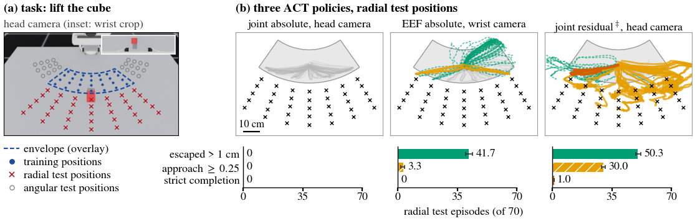

<div align="center">

# Escape Is Not Success: Diagnosing Spatial-OOD Failures of Robot Action Interfaces

**Juno Kim**<sup>1</sup> · **Yesol Park**<sup>1</sup> · **Hye-Jung Yoon**<sup>1</sup> · **Byoung-Tak Zhang**<sup>1</sup>

<sup>1</sup>Seoul National University

**[CoRL 2026 Workshop on Everything Beneath the Policy](https://beneath-the-policy.github.io/)**

<a href="https://openreview.net/forum?id=nRU0GzU0Hc"></a>&nbsp;
<a href="https://beneath-the-policy.github.io/"></a>&nbsp;
<a href="LICENSE"></a>&nbsp;
&nbsp;




</div>

> **TL;DR:** Zero success can hide different failures: score escape, approach and strict completion separately to distinguish staying put, departing without approaching, and approaching without lifting. ACT policies with near-identical success stop at different stages.

## Abstract

Success conflates policies that stay put with those that approach but fail to lift. We score escape, distance-normalised approach and strict completion in simulated cube lifting (targets 5–25 cm radially and 10–30° angularly beyond demonstrations; three training seeds per cell). Three ACT policies complete 0, 0 and 1 of 70 radial episodes per seed yet differ: one stays within 1 cm of the demonstrated region, one escapes but rarely approaches, and one often approaches but rarely completes. Absolute arms approach in at most 4 of 70 radial episodes per seed in either frame and, for EEF commands, with every camera tested; residual arms in 27–60. Under residual EEF commands, a wrist camera adds 19–32 strict radial completions per seed; absolute policies rarely approach, so their zero completions cannot isolate camera effects. Per-seed stages and matched contrasts expose interface failure modes.

## Overview

A Franka Panda lifts a 5 cm cube in Isaac Lab. Demonstrations lie within a polar envelope,
`r ∈ [0.325, 0.525] m, |θ| ≤ 35°`; radial test targets sit 5–25 cm beyond it.
The evaluation scores three stages independently:

- **Escape:** the grasp point's maximum excursion beyond the demonstrated envelope is strictly greater than 1 cm.
- **Approach:** distance-normalised progress toward the object's nominal spawn position is ≥0.25.
- **Strict completion:** the cube centre stays at least 1 cm above rest height and within 6 cm of the grasp point in the plane at three consecutive checks, 15 control steps apart.

See [the reproduction guide](docs/REPRODUCE.md) for the metric definitions and full task and training recipe.

## Contents

- [Installation](#installation)
- [Usage](#usage)
- [Results](#results)
- [Repository layout](#repository-layout)
- [Citation](#citation)
- [Acknowledgements](#acknowledgements)
- [License](#license)

## Installation

Use Linux, an NVIDIA GPU, Python 3.11 and an installed Isaac Sim 5.1 distribution.
See [docs/INSTALL.md](docs/INSTALL.md) for the environments, ACT patch, environment
variables, FFmpeg and wrist-camera setup. From the repository root:

```bash
git submodule update --init third_party/IsaacLab third_party/act
export ISAACSIM_PATH=/path/to/isaac-sim-5.1
bash scripts/setup/install.sh
source scripts/setup/activate_sim.sh
```

## Usage

Run the pipeline from the repository root. Full step-by-step instructions, collection
verification, calibration and measured resources are in [docs/REPRODUCE.md](docs/REPRODUCE.md).
The example trains one run; repeat training and evaluation for the runs listed by the driver.
Start the policy server in an ACT terminal and evaluate in a separate simulation terminal.

```bash
# 1. Build the scene and cube assets (simulation environment)
python3 scripts/reproduce.py scene --execute
# 2. Check achievability (simulation environment)
python3 scripts/reproduce.py gate --execute
# 3. Collect demonstrations (simulation environment)
python3 scripts/reproduce.py collect --execute
# 4. Convert the training split (simulation environment)
python3 scripts/reproduce.py convert --execute
# 5. Train a policy (ACT environment)
python3 scripts/reproduce.py train --run act --execute
# 6. Serve the checkpoint (ACT terminal; keep running)
python3 scripts/reproduce.py serve --run act --port 6000 --execute
# 7. Evaluate the served checkpoint (separate simulation terminal)
python3 scripts/reproduce.py evaluate --run act --port 6000 --execute
# 8. Regenerate results and figures after capturing the figure inputs (simulation environment)
python3 scripts/reproduce.py report --execute
```

Quick checks with no simulator needed (Python standard library only):

```bash
python3 scripts/run_checks.py
python3 scripts/bench/check_self_contained.py
python3 scripts/paper/summarize.py --published
python3 scripts/reproduce.py list
python3 scripts/reproduce.py train --run act
```

The reproduction driver prints commands by default; `--execute` runs a stage. Raw
evaluation JSONs, demonstrations, rendered rollouts and checkpoints are not included.

## Results

The main 2×2 comparison uses a head camera and absolute gripper commands. Each entry
lists training seeds 0/1/2, out of 70 radial test episodes per seed.

| Frame | Arm commands | Escaped >1 cm | Approach ≥0.25 | Strict completion |
|---|---|---|---|---|
| Joint | Absolute | 0/0/0 | 0/0/0 | 0/0/0 |
| Joint | Per-step residual | 62/48/68 | 53/35/60 | 10/5/4 |
| EEF | Absolute | 0/12/0 | 0/0/0 | 0/0/0 |
| EEF | Per-step residual | 60/67/66 | 44/56/57 | 3/7/9 |

*Escape = excursion >1 cm; approach = distance-normalised progress ≥0.25; strict completion = sustained lift meeting the height, proximity and consecutive-check thresholds above; counts are shown for seeds 0/1/2.*

> Closed-loop re-evaluation is not bitwise reproducible, so per-seed stage and completion
> counts can differ slightly from the paper.

Absolute EEF uses quaternion orientation; residual EEF uses a rotation vector. A separate
absolute rotation-vector control matches the latter format. The full table, query anchoring,
camera comparisons and zeroed-state controls are in [results/paper_cells.json](results/paper_cells.json).
Each seed names its source run and evaluation tag; [results/recipes.json](results/recipes.json)
specifies every reported model configuration.

## Repository layout

```text
escape_ood/
├── suites/            # lift grid, splits, envelope, cameras and gate evidence
├── collect/           # scripted expert, queue, recorder and shared predicates
├── sim/env/           # scene construction and motion backend
├── sim/tools/         # gate, collection, evaluation and figure capture
├── splits/            # archive selection and EEF encodings
├── policy/act/        # measured-state query anchors
└── metrics/           # path and strict-completion measures
scripts/               # setup, reproduction, ACT tools, checks and paper figures
results/               # published counts, recipes and runtime measurements
assets/                # teaser image
third_party/           # pinned Isaac Lab and ACT submodules
docs/                  # installation and reproduction guides
```

## Citation

Machine-readable citation: [CITATION.cff](CITATION.cff) · [citation.bib](citation.bib).

```bibtex
@inproceedings{kim2026escape,
  title = {Escape Is Not Success: Diagnosing Spatial-{OOD} Failures of Robot Action Interfaces},
  author = {Kim, Juno and Park, Yesol and Yoon, Hye-Jung and Zhang, Byoung-Tak},
  booktitle = {CoRL 2026 Workshop on Everything Beneath the Policy},
  year = {2026},
  url = {https://openreview.net/forum?id=nRU0GzU0Hc}
}
```

## Acknowledgements

This work builds on [Isaac Lab](https://github.com/isaac-sim/IsaacLab) and
[ACT](https://github.com/tonyzhaozh/act). We thank the authors for releasing their code.

## License

Released under the [Apache-2.0 License](LICENSE). Submodules remain under their respective
licenses. See [NOTICE](NOTICE) for retained BSD-3-Clause notices and third-party licenses.
